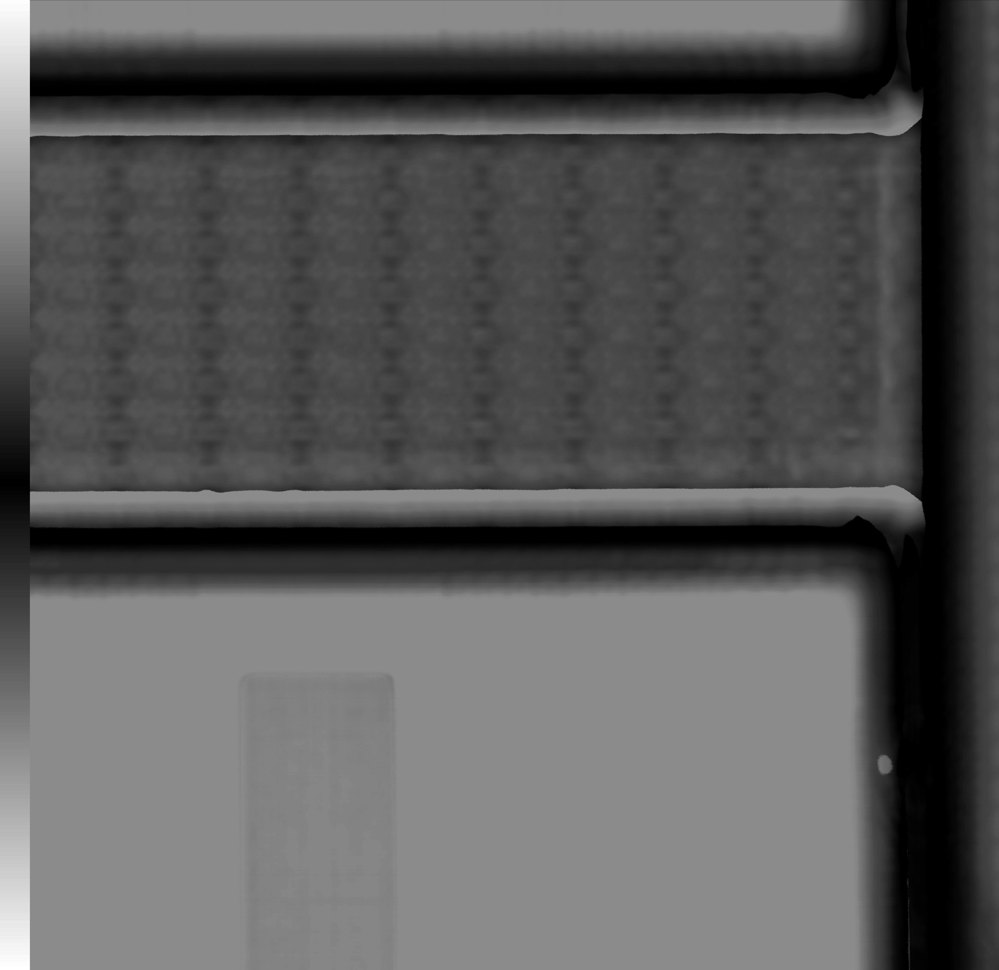

# Multi-Modal Microscopy Toolkit

A Python desktop application for loading, visualizing, and registering multi-modal microscopy and scan data (CT, SAM, optical, and mesh-based inputs).

## Repository Rename
This project has been renamed from `Multi_Modal_Spring2026` to **Multi-Modal Microscopy Toolkit**.

## Current Capabilities
- PySide6-based GUI for interactive workflows
- OpenGL-powered viewers for mesh, point cloud, and volume data
- Registration pipeline utilities (global/local alignment + ICP workflow components)
- Data import and conversion helpers for common imaging formats

## Project Structure
- `/Code` — main application source (GUI, controllers, widgets, utilities)
- `/UI` — Qt Designer UI files and generated UI bindings
- `/TestCode` — experimental scripts and prototype workflows
- `requirements.txt` — Python dependencies

## Setup
1. Create and activate a Python environment.
2. Install dependencies:
   ```bash
   pip install -r requirements.txt
   ```

## Run
From the repository root:
```bash
python3 Code/test.py
```

## UI Regeneration
When `Code/UI_V1.ui` changes, regenerate the Python UI module:
```bash
pyside6-uic Code/UI_V1.ui -o Code/ui_mainwindow.py
```

## Output Screenshots
Example output image from the current toolkit workflows:



## Roadmap
1. Strengthen modular ingestion across modalities and metadata styles.
2. Expand spatial alignment robustness across resolution and coordinate differences.
3. Improve defect-localization and region-based analytics.
4. Enhance side-by-side and overlaid visualization workflows.
5. Formalize repeatable data/metadata organization for scalable processing.
